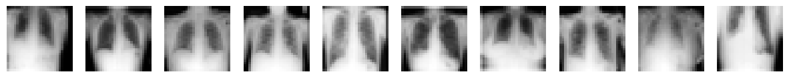
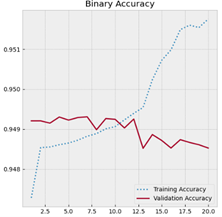
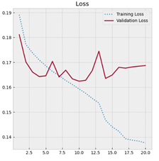
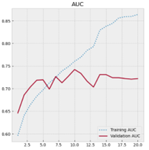
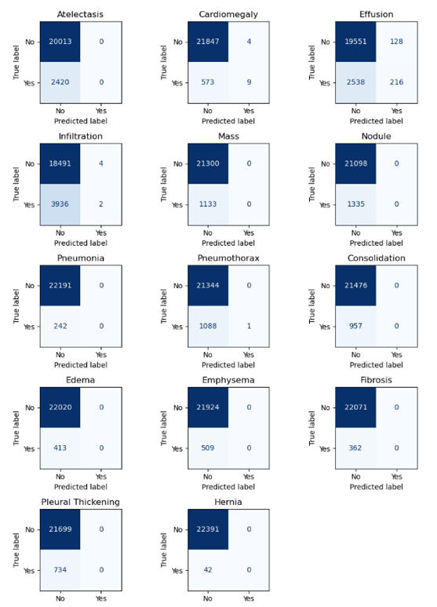

# Automated Thoracic Disease Detection with CNNs

[Paper (PDF)](paper/chestnet.pdf) · [LaTeX source](paper/chestnet.tex)

Taher Akolawala 

### Abstract

   I trained a small convolutional network (three conv blocks, about 392k parameters) to predict 14 thoracic findings at once from the 28×28 grayscale chest X-rays in ChestMNIST, using independent sigmoid outputs for the multi-label task and checkpointing on validation AUC. On the 22,433-image test split the model reaches a macro AUC of 0.735, meaning it ranks positive images above negative ones better than chance but only moderately, and at the default 0.5 threshold it almost never predicts a finding at all: recall is zero for 11 of the 14 findings, and the best case, effusion, catches 216 of 2,754 positive images (7.8%). The 94.77% binary accuracy the training loop reports is not evidence of anything here, because a model that answers "no finding" for every label on every image scores 94.74% on the same split. I treat the result as a low-resolution baseline whose obvious next steps are per-finding thresholds tuned on validation data and a class-weighted loss, and nothing in it supports clinical use.

## Introduction

   Chest X-ray interpretation is one of the most important tasks done in diagnostic medicine. Increasingly, however, the large volume of imaging data outpaces that capacity of radiology teams, which leads to delays in results and fatigue related errors. 

   This problem can be framed as a multi-label classification task, where a single X-ray can show evidence of multiple conditions. In this dataset the 14 possible conditions were: Atelectasis, Cardiomegaly, Effusion, Infiltration, Mass, Nodule, Pneumonia, Pneumothorax, Consolidation, Edema (Oedema), Emphysema, Fibrosis, Pleural Thickening, and Hernia. 

   Using the ChestMNIST dataset provided, which is a derivation of the NIH-ChestXray14 dataset, a deep learning solution was implemented to predict the probability of the 14 different diseases listed above simultaneously. 

## Methodology
   ### Data Preprocessing

   The dataset comprises 112,120 frontal-view X-ray images, split into training (78,468), validation (11,219), and testing (22,433) sets. The images were provided in a heavily down sampled resolution of 28 X 28 pixels. To prepare the data for the CNN, two critical steps were taken:

   1. Normalization: Pixel intensities were scaled from [0,255] to [0,1] to ensure faster convergence during gradient descent. 
   2. Dimension Expansion: Tensorflow’s Conv2D layers requires 4 dimensional input data in the format (Batch, Height, Width, Channel). To  accommodate this, I expanded the raw (N, 28, 28) arrays to (N, 28, 28, 1) to show that the images are in grayscale.

   
   *Figure 1: A few of the ChestMNIST images after preprocessing.*

   ### CNN Architecture

   A custom sequential CNN architecture was developed tailored to this low resolution dataset. Although a much larger model like ResNet50 may have done marginally better, it would not have been efficient and would also be massively prone to overfitting on simple 28 X 28 images. 

   - Feature Extraction: 3 convolutional blocks increasing in depth (32, 64, 128 filters) were used. I chose small 3 by 3 kernels to capture fine local details that are often not visible to the naked eye like tissue edges. Each convolutional block was followed by batch normalization to stabilize training and max pooling to reduce spatial dimensions.
   - Classification Head: The features were flattened and passed through a Dense layer (256 units) with Dropout (0.5). This regularization technique randomly ignores 50% of neurons during training, and forced the network to not memorize noise. 
   - Output Layer: The final layer consists of 14 neurons with a Sigmoid activation function. Sigmoid was used because it outputs an independent probability from 0 to 1 for each disease unlike other activation functions like SoftMax which forces probabilities to sum to 1. This made Sigmoid optimal for multi label classification. 

   The explicit model architecture table is shown below:

   | Layer Type                         | Output Shape           | Param # |
   |-----------------------------------|------------------------|---------|
   | Conv2D (32 filters, 3x3)           | (None, 28, 28, 32)     | 320     |
   | Batch Normalization                | (None, 28, 28, 32)     | 128     |
   | MaxPooling2D                       | (None, 14, 14, 32)     | 0       |
   | Conv2D (64 filters, 3x3)           | (None, 14, 14, 64)     | 18,496  |
   | Batch Normalization                | (None, 14, 14, 64)     | 256     |
   | MaxPooling2D                       | (None, 7, 7, 64)       | 0       |
   | Conv2D (128 filters, 3x3)          | (None, 7, 7, 128)      | 73,856  |
   | Batch Normalization                | (None, 7, 7, 128)      | 512     |
   | MaxPooling2D                       | (None, 3, 3, 128)      | 0       |
   | Flatten                            | (None, 1152)           | 0       |
   | Dense                              | (None, 256)            | 295,168 |
   | Dropout (0.5)                      | (None, 256)            | 0       |
   | Dense (Output)                     | (None, 14)             | 3,598   |

   - Total Parameters: 392,334 
   - Trainable Parameters: 391,886
   - Non-trainable Parameters: 448

   ### Training Strategy

   The model was compiled with the Adam optimizer with an initialized learning rate of 0.001 and Binary Cross entropy used as a loss function. Other best practices used were: 

   1. Early Stopping: To prevent overfitting, training stopped if Validation AUC did not improve for 10 epochs.
   2. ReduceLROnPlateau: The learning rate was reduced by a factor of 0.2 if the model stagnated, allowing it to fine-tune weights in smaller steps.
   3. ModelCheckpoint: Only the model weights with the highest Validation AUC were saved.

## Experimental Results
   ### Quantitative Performance

   Although max epochs were set to 50, the training process lasted 20 epochs before early stopping was triggered. The best model saved was from epoch 10. It had the following performance on the test set:

   | Metric | ChestNet | Always predict "no finding" |
   |---|---|---|
   | Macro AUC (mean over 14 findings) | **0.7353** | 0.5 |
   | Macro recall at 0.5 threshold | 0.007 | 0.0 |
   | Binary accuracy | 94.77% | 94.74% |
   | Binary cross-entropy loss | 0.1667 | n/a |

   I was pleased with the 95% accuracy when I first saw it, and it turned out to be almost exactly the base rate: only 16,510 of the 314,062 image-label pairs in the test split are positive, so predicting "no" everywhere already gets 94.74%. AUC is the number that carries information, and 0.735 says the model's scores rank sick images above healthy ones moderately well even though, at a fixed 0.5 cutoff, those scores almost never cross the line. 

   ### Learning Curves
   The learning curves illustrate the dynamics of training. As seen in Figure 4 (below), the Training AUC (dotted line) continues to rise indefinitely, while the Validation AUC (solid line) plateaus around Epoch 10. This divergence is a classic signature of overfitting; the model began memorizing the training data rather than generalizing. The Early Stopping callback successfully prevented this by restoring the weights from Epoch 10.

   Additionally, the loss curves support this diagnosis. While training loss decreased across all epochs, validation loss had more of u shape, and it reached a global minimum at Epoch 10. The rising validation loss confirms that the model began to diverge from the ground truth on unseen data after epoch 10. Notably, binary accuracy continued to rise across all epochs, and there was only a marginal difference between the final validation and training binary accuracy values. This stability can only be attributed to the severe class imbalance. The model is able to achieve high accuracy by predicting the majority classes, which, as mentioned before, makes AUC a much better metric than accuracy for this specific case. 

   |  |  |  |
   |:--------------:|:--------------:|:--------------:|
   | Figure 2 | Figure 3 | Figure 4 |
   | Binary Accuracy Learning Curve | Learning Curve for Loss Metric | Learning Curve for AUC |

   ### Quantitative Analysis: Confusion Matrices

   Confusion matrices at a 0.5 threshold for all 14 findings make the imbalance concrete. Only four findings get any true positives at all, and none gets many:

   | Finding | Positives in test set | Caught | Recall |
   |---|---|---|---|
   | Effusion | 2,754 | 216 | 7.8% |
   | Cardiomegaly | 582 | 9 | 1.5% |
   | Pneumothorax | 1,089 | 1 | 0.09% |
   | Infiltration | 3,938 | 2 | 0.05% |
   | The other 10 findings | 42 to 2,420 each | 0 | 0% |

   The model has learned that predicting "healthy" is the statistically safest answer under binary cross-entropy with no class weighting, and every one of those misses is a false negative, which is the expensive kind of error in a medical setting. Because AUC is threshold-independent, a lower per-finding threshold chosen on the validation set would recover some recall, and that is the first experiment I would run next. 

   |  |
   | :----------------------------------:|
   | *Figure 5: Confusion Matrices for all 14 diseases. Note the heavy concentration of predictions in the "No" columns, indicating the model favors specificity over sensitivity due to dataset imbalance.*|

## Implementation and Usage Discussion
   ### Limitations and Potential Use Case

   The current limitations for the model are the dataset characteristics. First that the resolution is only 28 by 28 which makes it insufficient for the purposes of radiology. Nodules become hard to decipher from noise. The second limitation is the class imbalance. Ideally, there would be a much larger selection of chest X-ray images for rarer diseases as well. 

   The use case I had in mind was worklist prioritization, where the model's scores rank X-rays so that likely-positive studies reach a radiologist first, which only needs the ranking that AUC measures and not a calibrated threshold. A 0.735 AUC on 28×28 images is nowhere near good enough for that, and the model has not been validated on any external data, so this stays a direction for a much stronger model and not a claim about this one. 

   ### Future Improvements

   To improve the model the following steps can be implemented on the same dataset:

   1. Per-finding thresholds: choose each finding's cutoff on the validation set for a target sensitivity, then fix it before touching the test set.
   2. Weighted loss: class weights or focal loss to penalize a missed positive more heavily than a false alarm.
   3. Data augmentation: for rarer findings, the number of positive examples can be increased by rotating, zooming, or flipping the existing positive samples. 
   4. Higher resolution: MedMNIST+ also ships ChestMNIST at 64, 128, and 224 pixels, and small findings like nodules are close to invisible at 28×28. 

## Conclusion

   ChestNet reaches a macro test AUC of 0.7353 on ChestMNIST, which is a reasonable baseline for a 392k-parameter CNN on 28×28 images, but at the default threshold it misses nearly every positive case and its accuracy is indistinguishable from always predicting "no finding". Per-finding thresholds, a class-weighted loss, and higher-resolution inputs are the changes I expect to matter, and any claim about clinical usefulness would need all three plus external validation.

**To run the code**: Clone the repository, download `chestmnist.npz` (the 28×28 version) from the [MedMNIST Zenodo record](https://zenodo.org/records/10519652) into the repo folder, and download the trained model from the [v1.0 release](https://github.com/taherakolawala/chestnet/releases/tag/v1.0) (`gh release download v1.0 -R taherakolawala/chestnet`). Then open test.ipynb and run all cells; it evaluates on the test set and draws the confusion matrix for each finding.
**To use a different dataset**: Ensure the new data has the shape (N, 28, 28) and that the images are grayscale. Open the training notebook and locate the second code cell. Replace the code:
`chestdata = np.load('[YOUR_DATA].npz')`. Then run all cells again. You can tweak the user parameters of learning rate, batch size, epochs, and architecture neuron counts if you wish. 
